### Every star is a repo I built.
Older projects orbit close to the core and newer ones drift toward the rim. Bigger stars have more commits, and a pulsing ring means the repo was active this month. The whole sky is regenerated every day from live GitHub data.

 

### 🛰️ Recent orbits

<!--RECENT:START-->
| | repo | language | commits | last signal |
|---|---|---|---|---|
| 🟢 | [**comic-book-pipeline**](https://github.com/nhanvu0901/comic-book-pipeline) | Python | 668 | today |
| 🟡 | [**cyber-learn**](https://github.com/nhanvu0901/cyber-learn) | Python | 2 | 8d ago |
| 🟡 | [**project-agent-setup-skill**](https://github.com/nhanvu0901/project-agent-setup-skill) | Python | 1 | 11d ago |
| 🟡 | [**book-rewrire**](https://github.com/nhanvu0901/book-rewrire) | Python | 26 | 15d ago |
| ⚪ | [**tender**](https://github.com/nhanvu0901/tender) | TypeScript | 22 | 34d ago |
<!--RECENT:END-->

How this works

 

`scripts/generate.py` calls the GitHub API and draws two hand-built animated SVGs, using SMIL orbits and CSS keyframes. A daily GitHub Action re-runs it and commits the result. It has no dependencies and uses no third-party widgets.

